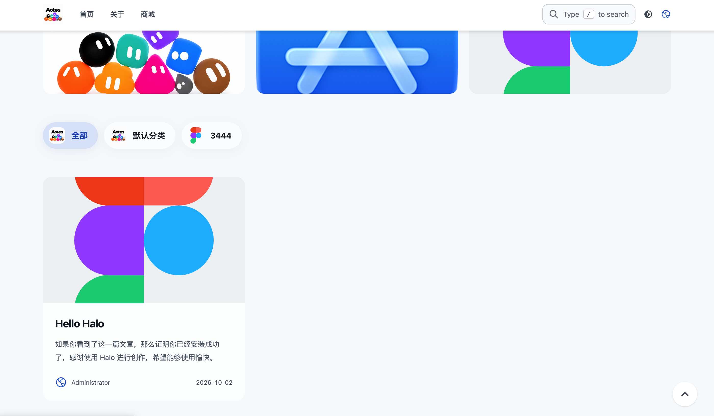
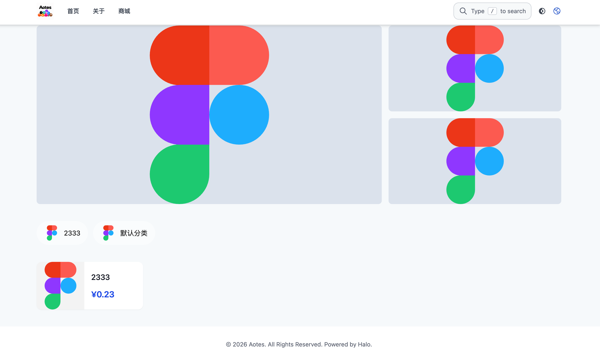
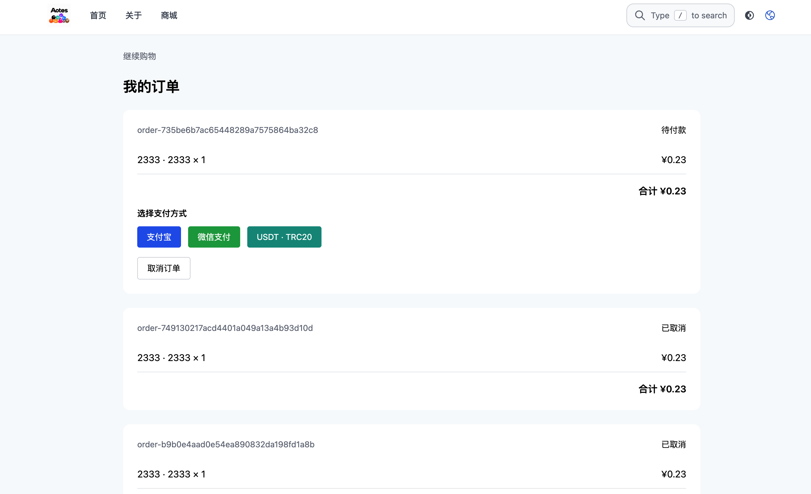

# AOSTE 主题与商城

AOSTE 是一款用于 Halo 的网站主题，适合展示文章，也可以搭配随包提供的商城插件使用。首页内容可以在 Halo 后台按自己的需要调整，不必修改代码。

在线体验：[https://halo-deve.txsw.top](https://halo-deve.txsw.top)

## 下载包里有什么

下载 `AOSTE-1.19.8-with-commerce-plugin.zip` 后，请先在电脑上解压。里面有两个需要分别安装的文件：

- `theme-aoset-1.19.8.zip`：AOSTE 网站主题。
- `plugin-commerce-0.2.6.jar`：商城插件。

外层压缩包只是把主题和插件放在一起，不能直接作为一个主题上传。

## 安装前

请使用 Halo 2.26 或更高版本。商城插件需要 Halo 2.26 及以上版本；本组合包按这个版本要求准备。

## 安装步骤

1. 下载组合包并解压。
2. 在 Halo 后台打开「插件」，上传 `plugin-commerce-0.2.6.jar`，安装并启用商城插件。
3. 打开「外观 → 主题」，上传 `theme-aoset-1.19.8.zip`，然后启用 AOSTE。
4. 进入主题的「首页布局」，配置首页内容并保存。

主题和插件是两个独立的安装项。只安装主题可以使用主题页面；需要商城功能时，还要安装并启用商城插件。

## 独立更新

插件列表会自动检查 GitHub Releases。有新版本时，Aoste主题插件旁会显示「有新版本」「查看详情」和「立即更新」。点击「立即更新」后确认，即可下载、校验并升级插件。检查失败会明确显示原因入口。

安装并启用商城插件后，在「主题」页面点右上角「主题管理」，再从 AOSTE 详情的「升级」打开 GitHub Releases 更新页。该页会显示主题和插件的当前版本、最新版本、Halo 版本要求与更新说明；有新版本时可分别升级。也可以打开「插件 → Aoste主题插件 → 设置 → 独立更新」，或直接打开 `/console/aoste/updates`。

更新来自 [GitHub Releases](https://github.com/cnmbdb/halo/releases)，不需要在 Halo 官方应用市场上架。后台从仓库的静态更新清单读取 AOSTE 的正式发布版本，不消耗 GitHub API 的未认证请求配额。检查结果缓存一分钟，同一页面的并发检查会合并。后台只读取 AOSTE 的正式发布版本，不会把 Halo 主程序的版本误认为主题更新。下载的安装包通过大小与 SHA-256 校验后，才会交给 Halo 自带的升级接口。

主题升级保留主题配置，但会覆盖自行修改过的主题文件。插件升级时商城服务会短暂重启，商品、订单和已交付卡密数据保留。升级前可在更新页导出主题配置；需要完整恢复时，请同时使用 Halo 的站点备份功能。

检查更新时浏览器需要能连接 GitHub，下载安装包时 Halo 服务端也需要能连接 GitHub。升级操作需要超级管理员权限。检查或下载失败时会显示原因，校验失败的包不会被安装。旧版本首次接入时，请先从发布页下载新主题包和插件包，分别使用 Halo 自带的「升级」功能安装；后续即可在「独立更新」页操作。

## 首页可以这样设置

首页由四个区块组成，可在「首页布局」里分别设置是否显示：

- **幻灯片**：添加图片、设置展示高度、自动播放和图片点击后的跳转地址。
- **自定义卡片**：添加图片、GIF 或视频，设置卡片尺寸、显示数量和点击后的链接。
- **文章分类**：选择要展示的分类并设置胶囊按钮图片。访客点击分类后，首页下方的文章列表会随之筛选；「全部」按钮也可以单独设置图片。
- **文章卡片列表**：展示 Halo 中的文章。文章布局和每页数量沿用 Halo 的文章相关设置。

首页分类按钮负责筛选首页文章，不会把访客带离首页。

## 页面预览

**首页分类筛选与文章卡片**



**商城商品与分类**



**商城订单与支付方式**



## 关于商城和支付

商城页面由配套插件提供。启用插件后，可按站点需要配置商品和订单。在线支付还需要你自己准备并填写支付网关信息；组合包不包含商户账号或支付密钥。正式开放前，建议先在自己的站点检查商品展示、下单和支付配置。

## 商城插件 0.1.1 修复

修复了新订单预占库存时清空历史卡密交付记录的问题。已付款订单的卡密会在后续下单、取消订单和重复支付回调中保留；对应的已交付预占记录也会保留，以支持迟到的重复回调。

已通过 91 项自动化测试，覆盖连续下单、取消订单、重复与迟到的支付回调、并发支付及库存预占重试。旧版本已经清空的卡密记录，需要从丢失前的备份恢复。

## 主题 1.19.8 / Aoste主题插件 0.2.6

插件名称统一为「Aoste主题插件」，使用主题同款图标，并在插件设置和 Halo 自带的主题升级弹窗中提供独立更新入口。主题的网站地址改为 https://hfz.pw/archives/2675。更新通过 Halo 插件扩展点接入，不修改 Halo 核心；大于 256 KB 的安装包也可正常下载校验。

## 反馈与源码

如果遇到问题或想查看项目源码，可以前往 [AOSTE 项目与问题反馈页](https://github.com/cnmbdb/halo)。

<!-- aoste-release-source
{
  "tag_name": "aoste-v1.19.8",
  "html_url": "https://github.com/cnmbdb/halo/releases/tag/aoste-v1.19.8",
  "draft": false,
  "prerelease": false,
  "body": "AOSTE 主题 1.19.8 · 商城插件 0.2.6\n\n修复 GitHub API 限流影响独立更新的问题：从公开仓库静态清单检查版本，通过固定的 Release 地址下载安装包。合并并发检查，缓存一分钟。主题封面已同步更新。插件列表支持 GitHub Releases 新版本提示，可点击「查看详情」或「立即更新」。立即更新进入确认流程，经大小与 SHA-256 校验后通过官方 Halo 接口升级。主题升级弹窗继续提供 AOSTE 独立更新入口，不修改 Halo 核心。\n\n「独立更新」页：在官方 Halo 后台检查、下载并升级主题和商城插件，更新来自 GitHub Releases，无需官方应用市场。\n安装包通过大小与 SHA-256 校验后才会提交升级；修复了 WebFlux 默认 256 KB 缓冲限制导致较大安装包下载失败的问题。支持版本比较、Halo 兼容检查、更新说明、配置导出和升级结果确认。\n保留插件 0.1.1 的历史卡密交付修复。\n\n首次安装或从旧版升级：下载完整安装包并解压，分别安装/升级其中的主题 ZIP 和插件 JAR，启用插件与主题。\n后续更新：主题 → 独立更新，插件 → Aoste主题插件 → 设置 → 独立更新，或 /console/aoste/updates。\n最低运行环境：官方 Halo 2.26。主题配置、商品与订单数据会保留；主题自定义文件会被覆盖，插件升级期间商城服务会短暂重启。\n\n独立文件：theme-aoset-1.19.8.zip 为可直接安装的主题；plugin-commerce-0.2.6.jar 为商城插件。\nAOSTE-1.19.8-with-commerce-plugin.zip 是组合包，先解压再安装；GitHub 自动生成的 Source code 压缩包不是安装包。\n\n```aoste-update\n{\n  \"schemaVersion\": 1,\n  \"theme\": {\n    \"id\": \"theme-aoset\",\n    \"version\": \"1.19.8\",\n    \"asset\": \"theme-aoset-1.19.8.zip\",\n    \"requires\": \">=2.26.0\",\n    \"sha256\": \"ceb9e5cfff907e9b828648d7b0c797688c0f1eca0e169ce0bc81f539940ad52e\"\n  },\n  \"plugin\": {\n    \"id\": \"commerce\",\n    \"version\": \"0.2.6\",\n    \"asset\": \"plugin-commerce-0.2.6.jar\",\n    \"requires\": \">=2.26.0\",\n    \"sha256\": \"4388ba151119fe20788527b17da5205471453fdaafd78d2dc596031b4def02f4\"\n  }\n}\n```\n",
  "assets": [
    {
      "id": 636544921,
      "name": "AOSTE-1.19.8-with-commerce-plugin.zip",
      "size": 7649381,
      "state": "uploaded",
      "browser_download_url": "https://github.com/cnmbdb/halo/releases/download/aoste-v1.19.8/AOSTE-1.19.8-with-commerce-plugin.zip",
      "digest": "sha256:4ab6592359e3fe7f9c0f1985acdef61c0082c1f0711c43276408bf6d4d15b7c9"
    },
    {
      "id": 636544922,
      "name": "plugin-commerce-0.2.6.jar",
      "size": 1907776,
      "state": "uploaded",
      "browser_download_url": "https://github.com/cnmbdb/halo/releases/download/aoste-v1.19.8/plugin-commerce-0.2.6.jar",
      "digest": "sha256:4388ba151119fe20788527b17da5205471453fdaafd78d2dc596031b4def02f4"
    },
    {
      "id": 636544924,
      "name": "theme-aoset-1.19.8.zip",
      "size": 4782704,
      "state": "uploaded",
      "browser_download_url": "https://github.com/cnmbdb/halo/releases/download/aoste-v1.19.8/theme-aoset-1.19.8.zip",
      "digest": "sha256:ceb9e5cfff907e9b828648d7b0c797688c0f1eca0e169ce0bc81f539940ad52e"
    },
    {
      "id": 636544923,
      "name": "updates.json",
      "size": 457,
      "state": "uploaded",
      "browser_download_url": "https://github.com/cnmbdb/halo/releases/download/aoste-v1.19.8/updates.json",
      "digest": "sha256:64b78ad346d53aa457919bfb0f332105e7ea2872cf695cd97265c0abf5c6b680"
    }
  ]
}
-->
